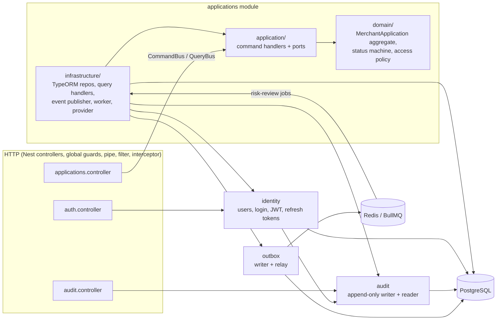
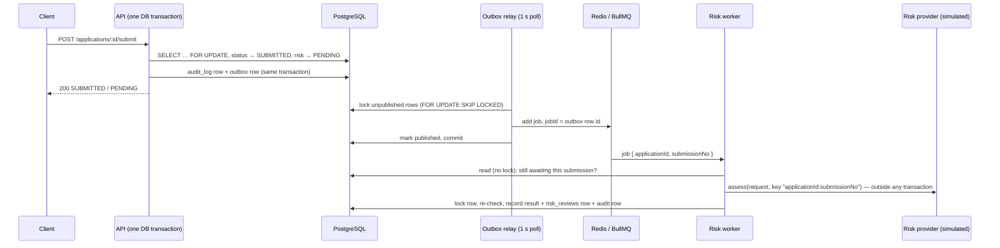
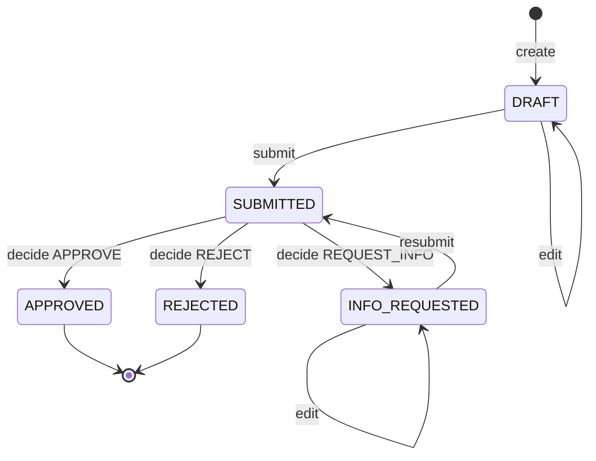

# Merchant Applications API

A NestJS service for onboarding merchants onto a payments platform. Sales staff create merchant applications, a background worker runs a (simulated) KYB/risk check, and an assigned reviewer approves, rejects or asks for more information. Every significant action lands in an append-only audit trail.

**Stack:** Node 24 · TypeScript 5.9 · NestJS 11 · PostgreSQL 16 + TypeORM (hand-written migrations) · Redis 7 + BullMQ · JWT · Swagger · Jest + Supertest · Docker Compose.

---

## Contents

1. [Run it](#run-it)
2. [Architecture](#architecture)
3. [Domain rules](#domain-rules)
4. [API](#api)
5. [Reliability](#reliability)
6. [Security](#security)
7. [Testing](#testing)
8. [Trade-offs and what I'd do next](#trade-offs-and-what-id-do-next)
9. [Multi-tenancy](#multi-tenancy)
10. [AI usage](#ai-usage)

---

## Run it

**Prerequisites:** Docker, and Node 24.7+ for seeding and tests (Node's built-in `crypto.argon2` arrived in 24.7).

```bash
cp .env.example .env
# Fill in the four secrets, e.g. with: openssl rand -base64 48
#   JWT_SECRET, DB_OWNER_PASSWORD, DB_PASSWORD, SEED_USER_PASSWORD (12+ characters)

docker compose up --build -d   # postgres, redis, migrate (one-off), api on 127.0.0.1:3000
npm ci
npm run seed                   # five fake @example.com users, password = SEED_USER_PASSWORD
```

Open **http://localhost:3000/docs** for Swagger. Seeded users: `admin@example.com` (ADMIN), `sales.one@` / `sales.two@` (SALES), `reviewer.one@` / `reviewer.two@` (REVIEWER), all `@example.com`.

A full lifecycle from the command line:

```bash
PW='<your SEED_USER_PASSWORD>'
login() { curl -s localhost:3000/auth/login -H 'content-type: application/json' \
  -d "{\"email\":\"$1\",\"password\":\"$PW\"}" | node -pe 'JSON.parse(require("fs").readFileSync(0)).accessToken'; }
SALES=$(login sales.one@example.com); ADMIN=$(login admin@example.com); REVIEWER=$(login reviewer.one@example.com)

ID=$(curl -s localhost:3000/applications -H "authorization: Bearer $SALES" -H 'content-type: application/json' -d '{
  "businessName": "Example Coffee", "legalBusinessName": "Example Coffee LLC", "businessType": "LLC",
  "ownerContact": { "fullName": "Jane Example", "email": "jane@example.com", "phone": "+15550100123" },
  "processingInfo": { "monthlyVolumeCents": 2500000, "averageTicketCents": 4500, "mcc": "5812" } }' \
  | node -pe 'JSON.parse(require("fs").readFileSync(0)).id')
curl -s -X POST localhost:3000/applications/$ID/submit -H "authorization: Bearer $SALES"   # riskStatus PENDING
sleep 2   # the worker records riskStatus LOW within a second or two
```

Then assign a reviewer (`POST /applications/:id/assignment` as ADMIN, with a reviewer's user id) and decide (`POST /applications/:id/decision` as that reviewer). `GET /audit?entityId=$ID` as ADMIN shows the trail.

**Without Docker for the API** (fast reload): `docker compose up -d postgres redis`, then `npm run migration:run`, `npm run seed`, `npm run start:dev`.

### Scripts

| Script                                            | What it does                                                                                                                 |
| ------------------------------------------------- | ---------------------------------------------------------------------------------------------------------------------------- |
| `npm run lint`                                    | ESLint, Prettier check and dependency-cruiser layer rules                                                                    |
| `npm run typecheck` / `npm run build`             | `tsc --noEmit` / Nest build to `dist/`                                                                                       |
| `npm test`                                        | Unit tests (no database)                                                                                                     |
| `npm run test:e2e`                                | Integration and API tests against `<DB_NAME>_test` and Redis db `REDIS_DB + 1` (needs `docker compose up -d postgres redis`) |
| `npm run migration:run` / `:revert` / `:generate` | TypeORM CLI as the schema owner                                                                                              |
| `npm run seed`                                    | Upserts the five fake users                                                                                                  |

### Configuration

Validated at startup (`AppConfig`); the process refuses to start with a missing or invalid variable, and error messages name the variable, never its value. See `.env.example` for the full list. Two worth knowing: `RISK_PROVIDER_FAILURES` makes the simulated provider fail the first N calls per submission (5+ exhausts the retries), and `REDIS_DB` keeps dev and test queues apart.

---

## Architecture

A modular monolith. `applications` is fully hexagonal; `identity`, `audit` and `outbox` are deliberately lean (services over TypeORM, no domain layer) because they hold little business logic.



### Layer rules (enforced by dependency-cruiser in `npm run lint`)

| Layer               | May import                                           | Must not import                                                      |
| ------------------- | ---------------------------------------------------- | -------------------------------------------------------------------- |
| `domain/`           | `shared/domain`                                      | `@nestjs/*`, `typeorm`, `bullmq`, `class-validator`, any outer layer |
| `application/`      | domain, ports, `@nestjs/common` (DI), `@nestjs/cqrs` | `typeorm`, `bullmq`, `express`, infrastructure, api                  |
| `infrastructure/`   | inner layers and frameworks                          | api                                                                  |
| `api/`              | command/query buses, DTOs                            | infrastructure                                                       |
| module A → module B | B's `index.ts` only                                  | deep imports into B                                                  |

Plus: no cycles, and `shared/` never imports a module. dependency-cruiser checks resolved paths, so a relative import that crosses a module boundary is caught too (ESLint's `no-restricted-imports` only sees import strings).

### Request flow: submit to risk result



### Project layout

```
src/
  main.ts, app.module.ts        bootstrap, Swagger, starts the outbox relay and the risk worker
  migrations/                   8 hand-written migrations (schema owner only)
  shared/
    domain/                     AggregateRoot, DomainError, Role/Actor
    application/                UnitOfWork and IdempotencyStore ports
    api/                        RFC 9457 problem-details filter, auth decorators, Idempotency-Key
    infrastructure/             config, data source + unit of work, logging + masking, BullMQ queues
  modules/
    applications/{domain,application,infrastructure,api}
    identity/                   users, argon2id, JWT guards, refresh tokens, seed script
    audit/                      append-only audit writer and ADMIN reader
    outbox/                     transactional outbox writer and relay
test/                           integration and API suites (Supertest), test DB helpers
```

---

## Domain rules



- **Risk status:** `NOT_STARTED` → `PENDING` on every (re)submission → `LOW | MEDIUM | HIGH` or `FAILED` (retries exhausted). Each submission has a number; a result for an older submission is ignored.
- **Decide** requires: status SUBMITTED; the caller is the **assigned** reviewer _and_ has the REVIEWER role (ADMIN can't decide); risk not PENDING; APPROVE needs a real result (a FAILED review can be rejected or sent back — resubmitting reruns it — but never approved); a reason (≤ 1000 chars) unless APPROVE.
- **Assign** only while SUBMITTED; reassigning is allowed until a decision. The target must be a REVIEWER.
- Rules live in the aggregate (`merchant-application.ts`) and are repeated as database CHECK constraints (e.g. a draft has never been submitted; an approval has a reviewer and a risk result; rejections carry a reason), so a bug that bypasses the domain still can't store an impossible row.
- Money is integer cents (`bigint`); average ticket ≤ monthly volume; MCC is 4 digits; phone is E.164.

### Access matrix

| Action          | SALES                              | REVIEWER                 | ADMIN                         |
| --------------- | ---------------------------------- | ------------------------ | ----------------------------- |
| create          | ✓                                  | ✗                        | ✓                             |
| read / list     | own only (others → **404**)        | everything except drafts | all                           |
| update / submit | own, while DRAFT or INFO_REQUESTED | ✗                        | ✓                             |
| assign reviewer | ✗                                  | ✗                        | ✓ (target must be a REVIEWER) |
| decide          | ✗                                  | assigned reviewer only   | ✗                             |
| read audit log  | ✗                                  | ✗                        | ✓                             |

Not visible answers **404**, identical to a missing id, so SALES users can't even learn that another user's application exists. Visible but not allowed answers **403**. The read scope is one function (`readScopeFor`) that the list/get SQL and the in-memory check both derive from, and a test checks they agree for every actor × application.

---

## API

| Method & path                            | Roles                          | Notes                                                                      |
| ---------------------------------------- | ------------------------------ | -------------------------------------------------------------------------- |
| `POST /auth/login`                       | public                         | 5 attempts/min/IP. Returns a 15-min access token and a 7-day refresh token |
| `POST /auth/refresh`                     | public (holds a refresh token) | Rotates the refresh token; re-reads the user's role                        |
| `POST /auth/logout`                      | public (holds a refresh token) | Ends that login's token family; 204                                        |
| `POST /applications`                     | SALES, ADMIN                   | `Idempotency-Key` supported                                                |
| `GET /applications?status=&page=&limit=` | all                            | Scoped per role; newest first; `limit` ≤ 100                               |
| `GET /applications/:id`                  | all                            | 404 if not visible                                                         |
| `PATCH /applications/:id`                | SALES (own), ADMIN             | Only while DRAFT / INFO_REQUESTED                                          |
| `POST /applications/:id/submit`          | SALES (own), ADMIN             | Starts a risk review; `Idempotency-Key` supported                          |
| `POST /applications/:id/assignment`      | ADMIN                          | `{ reviewerId }`; `Idempotency-Key` supported                              |
| `POST /applications/:id/decision`        | REVIEWER (assigned)            | `{ decision, reason? }`; `Idempotency-Key` supported                       |
| `GET /audit?entityId=&page=&limit=`      | ADMIN                          | Newest first                                                               |

**Errors** are RFC 9457 `application/problem+json` from one filter: validation (shape, types, unknown fields) → 400; domain errors map by kind: `invalid` → 422, `not_found` → 404, `forbidden` → 403, `conflict` → 409, each with a stable `code` (e.g. `NOT_ASSIGNED_REVIEWER`, `RISK_RESULT_REQUIRED`). Unique violations → 409 without constraint names or values; anything unexpected → a bare 500 (logged as message and stack only). Clients can't set `status`, `createdBy` or `assignedReviewerId`: the DTOs don't declare them and the global pipe rejects undeclared fields.

---

## Reliability

**Transactions.** A unit of work keeps the transaction's `EntityManager` in `AsyncLocalStorage`; nested `run()` calls join the outer transaction, so a command handler, the audit writer, the outbox writer and the idempotency store all commit or roll back together without passing a transaction around.

**Locking.** Every mutating command loads the application with `SELECT … FOR UPDATE`, so concurrent commands on one application queue instead of overwriting each other. Tested: five parallel decisions → exactly one 200, four 409, one decision stored.

**Transactional outbox.** A submission writes its audit row and an outbox row in the same transaction as the state change, so a job exists if and only if the submission committed. A relay polls every second, locks up to 100 unpublished rows with `FOR UPDATE SKIP LOCKED` (several instances share the work), adds a BullMQ job with `jobId` = outbox row id, then marks the rows published. If it crashes between `add` and its commit, the row is re-sent and BullMQ ignores the repeated `jobId`. Job payloads carry ids only — no applicant data in Redis.

**Risk worker.** 5 attempts with exponential backoff (1, 2, 4, 8 s). The provider is called _outside_ any transaction (no row lock held while a third party responds), with the idempotency key `applicationId:submissionNo`. The result is applied under the row lock, where the aggregate checks the submission is current and still PENDING; duplicates and stale jobs are no-ops. A unique `(application_id, submission_no)` on `risk_reviews` is the last line of defence. On the final attempt the worker itself marks the review FAILED (inside the job, not in a `failed` listener, so BullMQ's stalled-job recovery covers it). Tested end to end: provider fails twice → one LOW result after 3 attempts; never answers → FAILED after 5; a duplicate job → still one result.

**HTTP idempotency.** `Idempotency-Key` on create, submit, assignment and decision. The key row (per user), the command and the stored response share the request's transaction: a concurrent duplicate blocks on the primary key and then replays; the same key with a different method, path or body → 422; a failed request rolls its key back, so the client can retry. Replays carry `Idempotent-Replayed: true`.

**Shutdown.** `enableShutdownHooks`: the relay and worker stop first (letting running jobs finish), then queues and the database close.

---

## Security

**Authentication.** Passwords hashed with argon2id (Node's built-in `crypto.argon2`, OWASP parameters: 19 MiB, t=2, p=1); unknown emails still run a verify, so they cost the same as a wrong password and answer identically. Access tokens: HS256, 15 minutes, `iss`/`aud` pinned on verify (`alg: none`, other algorithms, wrong issuer/audience, tampering and expiry are tested). Refresh tokens: 256 random bits, stored only as SHA-256, single use; presenting a rotated token revokes the whole family and is audited (`RefreshTokenReuseDetected`).

**Authorization.** Two global guards: JWT first, then roles. Deny by default — a route with neither `@Public()` nor `@Roles()` is 403. Roles are the coarse gate; object-level rules live in the domain (access policy and aggregate), so a forgotten controller check can't bypass them. The SALES isolation tests (read, update, submit, list, status filter, forged `createdBy`) are in `test/applications.e2e-spec.ts`; each isolation point was mutation-checked.

**Least-privilege database.** The API connects as `DB_USER`, which can read and write rows but owns nothing: it can't create, alter, drop, truncate, disable triggers or change `session_replication_role` (tested). Migrations run as the owner in a one-off `migrate` container, so the API never holds owner credentials. The audit log is append-only twice over: UPDATE/DELETE are revoked from the app role, and a trigger refuses them even for the owner.

**Secrets.** Nothing usable in git: `.env.example` has placeholders, seed and test passwords come from the environment or are generated, CI generates throwaway masked secrets per run, and gitleaks scans the full history in CI. Config validation never echoes values.

**Logging and audit.** Structured JSON logs (pino). Every log entry passes through one sensitive-field registry: secrets (passwords, tokens, authorization headers, cookies, card/bank/tax ids) are replaced with `[REDACTED]`, personal data is partially masked (`j***@example.com`, `***0123`, `J***`). Request bodies and query strings are never logged. Audit metadata goes through the same masking; events carry ids and field names, never applicant data. Limitation: masking is by key, so free text (a decision reason) is stored as written.

**Data minimization.** No SSN, EIN, bank or card fields are collected. The risk provider receives business and processing details only, never the owner's contact details.

### Fields that need field-level encryption (documented, not implemented)

| Column                                  | Why                                      | Suggested approach                                                                                                           |
| --------------------------------------- | ---------------------------------------- | ---------------------------------------------------------------------------------------------------------------------------- |
| `merchant_applications.owner_full_name` | Personal data (identifies a person)      | Envelope encryption (KMS data key per record or per tenant), AES-256-GCM; decrypt only in the application layer              |
| `merchant_applications.owner_email`     | Personal data, contact channel           | Same, plus a keyed HMAC column if exact-match lookup is ever needed                                                          |
| `merchant_applications.owner_phone`     | Personal data, contact channel           | Same as email                                                                                                                |
| `merchant_applications.decision_reason` | Free text that may contain personal data | Same; it also lands in audit metadata, which would need the same treatment                                                   |
| Any future SSN/EIN/bank/card fields     | Regulated identifiers                    | Don't store raw card data at all (tokenize via the processor); encrypt the rest with separate keys and strict access logging |

Already protected another way: `users.password_hash` (argon2id), `refresh_tokens.token_hash` (SHA-256 of a random token; the database CHECK accepts only a hex digest, so a raw token can't be stored by mistake).

**Supply chain.** `ignore-scripts=true` (dependency install scripts never run), a one-week cooldown on new versions (`npm install --before=…`), CI actions pinned to commit SHAs with a read-only token, `npm audit --omit=dev` in CI.

---

## Testing

| Suite                                  | Count | What                                                                                                                                                                                                                                                                                                              |
| -------------------------------------- | ----- | ----------------------------------------------------------------------------------------------------------------------------------------------------------------------------------------------------------------------------------------------------------------------------------------------------------------- |
| Unit (`npm test`)                      | 288   | Aggregate and value objects, every status pair, access policy, command handlers with in-memory fakes, guards and JWT verification, masking, error mapping, worker retry logic, simulated provider                                                                                                                 |
| Integration / API (`npm run test:e2e`) | 161   | Real Postgres and Redis: auth flows and token attacks, SALES isolation, lifecycle and transitions, decision authorization, concurrency (parallel decisions, refreshes, idempotent requests), DB constraints and privileges, audit and outbox atomicity, the full risk pipeline with retries and exhausted retries |

**Mutation checking.** For the rules that matter (each isolation point, the row locks, the aggregate guards, the outbox and idempotency claims, DB constraints), I removed or broke the line and confirmed the named test fails, then restored it. Two concurrency tests (parallel decisions, parallel refreshes) at first passed with the lock removed, because the parallel requests never overlapped; they now hold the lock (or the key row) themselves first, so the overlap is deterministic and removing the lock fails them on every run.

CI (`.github/workflows/ci.yml`) runs three jobs on every push: lint/typecheck/build/unit tests/audit; integration tests against the same compose Postgres and Redis with throwaway secrets; gitleaks over the full history.

---

## Trade-offs and what I'd do next

- **Scope.** The brief targets a 6–8 hour core. I went further where it serves the rubric's reliability and security rows (transactional outbox, refresh-token rotation, HTTP idempotency keys) and skipped the optional extras (webhooks, MongoDB audit, a separate ADR — the decisions are recorded here instead).
- **One process runs the API, the relay and the worker.** Simple to run and test; in production I'd run the worker as its own deployment (same image, different entry point) so it scales and fails independently.
- **Outbox by polling** (1 s, `SKIP LOCKED`). Easy to reason about; at higher volume, `LISTEN/NOTIFY` or CDC (Debezium) would cut latency and load. Published outbox rows, old idempotency keys and expired refresh tokens are never deleted yet — a scheduled cleanup is the next job to add.
- **Pessimistic locks, no version column.** Mutations on one application are rare and short, so queueing is cheap and gives clear 409s; optimistic locking would suit high-contention, long-edit flows.
- **Refresh tokens are strict.** Two parallel refreshes with the same token count as reuse and end that login; many products allow a short grace window. Expiry slides 7 days per refresh with no absolute session cap; I'd add one (e.g. 30 days) and a "log out everywhere" endpoint.
- **Throttling is in memory, per instance**, on login only. Several instances would need Redis-backed throttler storage and `trust proxy`.
- **The risk provider is simulated** and deterministic. A real one needs a timeout, a circuit breaker and a data-processing agreement for what is sent.
- **Field-level encryption is documented, not built** (see the table above). Personal data is masked in logs and audit, but stored in plain text in Postgres.
- **No user management API** (users come from the seed script), no health/readiness endpoint, no metrics or tracing. With more time: `/health` (DB + Redis), OpenTelemetry traces across HTTP → outbox → job, and queue-depth metrics.

---

## Multi-tenancy

Considered and out of scope: the brief has no tenant concept. If merchants were onboarded by several ISOs or partners, the path would be:

- a `tenants` table, `tenant_id` on every table, and tenant-inclusive foreign keys and unique keys (e.g. `(tenant_id, id)`), so a row can't reference another tenant's row;
- Postgres row-level security on every table, with `FORCE ROW LEVEL SECURITY` so even the table owner is subject to it, and policies on `current_setting('app.tenant_id')`;
- the unit of work sets `SET LOCAL app.tenant_id = …` at the start of each transaction, and all reads run inside a transaction so the setting is always present;
- the tenant id comes from a JWT claim; platform staff who work across tenants get an explicit, audited cross-tenant policy rather than a bypass;
- the tenant id travels with everything asynchronous and stored: outbox rows, job payloads, idempotency keys, audit entries;
- tests that run raw SQL as the app role to prove one tenant can't read another's rows even if application code forgets a filter.

---

How the output was verified:

- the full check set before every commit: lint (including the layer rules), typecheck, build, unit tests, integration tests and `npm audit`, and gitleaks whenever tests contained secret-like values;
- mutation checks on the critical rules, as described in [Testing](#testing) — this is how two concurrency tests that couldn't fail were found and fixed;
- live probes of the built app for each feature (status codes against the access matrix, logs checked for errors and personal data);
- CI on every push and pull request, and a fresh-clone run of the whole setup (compose up, migrate, seed, all tests, gitleaks over the full history).
